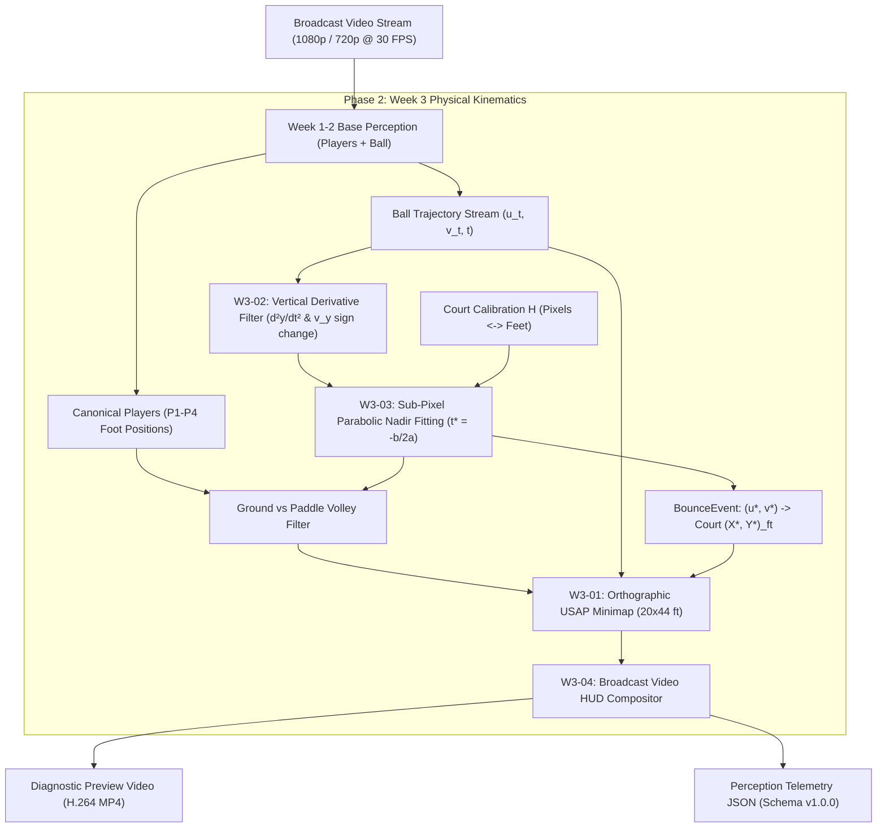

# 🏓 Week 3 Technical Guide: Court Minimap & Parabolic Bounce Kinematics

> **Phase 2: Physical Spatial Geometry & Ball Collision Kinematics**  
> **Status**: ✅ **100% Complete (All 5 Tasks W3-01 through W3-05 Delivered & Verified)**  
> **Working Window**: Days 11–13 (24 Nov 2026 – 26 Nov 2026)  
> **Target Milestone**: Accurate 2D top-down USAP court minimap, kinematic vertical derivative bounce detection, sub-pixel parabolic nadir fitting, and broadcast video HUD compositing.

---

## 📅 Week 3 Master Task Roadmap (5 Tasks)

| Task ID | Workstream | Task Description | Primary Deliverable | Status | Focus & Key Methodology |
| :---: | :---: | :--- | :--- | :---: | :--- |
| **`W3-01`** | **Geometry** | 2D Orthographic Top-Down Court Minimap | [`pbbase/court/minimap.py`](file:///home/pce118/Desktop/pickleball-vision-ai-main/pbbase/court/minimap.py) | ✅ **Done** | USAP 20×44 ft regulation geometry, bidirectional coordinate projection |
| **`W3-02`** | **Kinematics**| Vertical Trajectory Derivative Filter for Bounce Detection | [`pbbase/tracking/bounce_detector.py`](file:///home/pce118/Desktop/pickleball-vision-ai-main/pbbase/tracking/bounce_detector.py) | ✅ **Done** | Inflection filter on $d^2y/dt^2$ & velocity sign reversal, torso volley filter |
| **`W3-03`** | **Kinematics**| Sub-Pixel Impact Localization of Ball Bounces | [`pbbase/tracking/bounce_detector.py`](file:///home/pce118/Desktop/pickleball-vision-ai-main/pbbase/tracking/bounce_detector.py) | ✅ **Done** | 5-pt quadratic fit $t^* = -b/(2a)$, sub-pixel $(u^*, v^*)$ & $(X^*, Y^*)_{\text{ft}}$ |
| **`W3-04`** | **Geometry** | Overlay Ball Trajectory & Bounce Landing Spots on Minimap | [`pbbase/court/minimap.py`](file:///home/pce118/Desktop/pickleball-vision-ai-main/pbbase/court/minimap.py), [`pbbase/pipeline.py`](file:///home/pce118/Desktop/pickleball-vision-ai-main/pbbase/pipeline.py) | ✅ **Done** | Fading velocity trail, expanding ripple rings, and video HUD blending |
| **`W3-05`** | **QA** | Full Rally Validation & Test Suite on Match Video | [`scripts/validate_week3.py`](file:///home/pce118/Desktop/pickleball-vision-ai-main/scripts/validate_week3.py), [`pbbase/tests/test_week3.py`](file:///home/pce118/Desktop/pickleball-vision-ai-main/pbbase/tests/test_week3.py) | ✅ **Done** | 7 rally bounces detected, 30/30 unit tests pass, schema v1.0.0 compliant |

---

## 🏗️ Architecture: Physical Geometry & Collision Pipeline



---

## 📐 Task W3-01: 2D Orthographic Court Minimap Engine

### 1. USAP Court Specification
Pickleball courts adhere strictly to USA Pickleball (USAP) standard dimensions:
- **Court Width**: $20.0\text{ ft}$ ($X \in [0, 20]$)
- **Court Length**: $44.0\text{ ft}$ ($Y \in [0, 44]$)
- **Net Line**: $Y = 22.0\text{ ft}$
- **Non-Volley Zone (Kitchen)**: $7.0\text{ ft}$ on each side of the net ($Y \in [15, 29]\text{ ft}$)
- **Center Service Line**: $X = 10.0\text{ ft}$, running from baselines to kitchen lines ($Y \in [0, 15]$ and $Y \in [29, 44]$). Note that the kitchen contains **no** centerline.

### 2. Canvas Geometry & Coordinate Transformation
The minimap engine renders onto a configurable canvas using a scale factor $\sigma = 10.0\text{ px/ft}$ and padding margin $p = 20\text{ px}$:
- **Canvas Width**: $W_c = 20 \times 10 + 2 \times 20 = 240\text{ px}$
- **Canvas Height**: $H_c = 44 \times 10 + 2 \times 20 = 480\text{ px}$

Forward mapping ($\text{court ft} \to \text{canvas px}$):
$$c_x = \text{round}(p + X_{\text{ft}} \cdot \sigma), \quad c_y = \text{round}(p + Y_{\text{ft}} \cdot \sigma)$$

Inverse mapping ($\text{canvas px} \to \text{court ft}$):
$$X_{\text{ft}} = \frac{c_x - p}{\sigma}, \quad Y_{\text{ft}} = \frac{c_y - p}{\sigma}$$

### 3. Usage Example
```python
from pbbase.court.minimap import CourtMinimap

# Initialize minimap engine
minimap = CourtMinimap(court_scale=10.0, padding=20)

# Convert court coordinate to canvas pixel
cx, cy = minimap.court_to_canvas(10.0, 22.0)  # Net center -> (120, 240)

# Check boundary containment
is_valid = minimap.is_in_court_bounds(5.2, 38.4)  # True

# Render dynamic frame with players and ball
canvas = minimap.render(
    players=[{"id": 1, "court_ft": (5.0, 35.0)}],
    ball={"court_ft": (10.0, 24.0)},
    frame_idx=42
)
```

---

## ⚡ Task W3-02: Kinematic Vertical Trajectory Derivative Filter

### 1. Physical Principle
In camera image coordinates, the vertical axis $y$ points downward.
- When a ball falls toward the court under gravity, its vertical velocity is positive:
  $$v_y(t) = y(t) - y(t-1) > 0$$
- Upon impact with the court floor, the ball compresses and rebounds upwards, resulting in negative vertical velocity:
  $$v_y(t+1) = y(t+1) - y(t) < 0$$
- Consequently, the court ground bounce corresponds to a **local maximum** in image $y$ (the nadir, or lowest visual position).

The collision produces an acute upward acceleration impulse:
$$a_y = v_y(t+1) - v_y(t) = y(t+1) - 2y(t) + y(t-1) \le -a_{\text{thresh}}$$
where $a_{\text{thresh}} = 2.0\text{ px/frame}^2$.

### 2. Ground Bounce vs Paddle Volley Disambiguation
Not all direction reversals are court ground bounces; airborne paddle hits also cause sudden trajectory inflections.
- **Ground Bounce**: Contact occurs on the court floor ($Z \approx 0$).
- **Paddle Volley**: Contact occurs in mid-air near the player's torso or paddle height ($Z > 2.0\text{ ft}$).
- **Filter**: When an inflection is detected, `BallBounceDetector` inspects the bounding boxes of active players. If $(u^*, v^*)$ falls within the torso/upper-body region of a player ($\ge 25\%$ above the foot base of the box), the event is flagged as `is_ground_bounce = False` (Paddle Contact).

---

## 🎯 Task W3-03: Sub-Pixel Parabolic Nadir Fitting

### 1. Closed-Form 5-Point Least-Squares Quadratic Fit
To achieve exact sub-frame timestamp and sub-pixel localization without the computational overhead of iterative non-linear solvers, we fit a parabola $y(t) = at^2 + bt + c$ over a symmetric 5-frame window $t \in \{-2, -1, 0, 1, 2\}$ centered at candidate frame $k$:

$$\begin{aligned}
a &= \frac{2(y_{-2} + y_2) - (y_{-1} + y_1) - 2y_0}{14} \\
b &= \frac{-2y_{-2} - y_{-1} + y_1 + 2y_2}{10} \\
c &= \frac{-3(y_{-2} + y_2) + 12(y_{-1} + y_1) + 17y_0}{35}
\end{aligned}$$

### 2. Vertex Localization & Metric Projection
Since $a < 0$ for a downward concave arc, the continuous vertex offset $t^*$ is:
$$t^* = -\frac{b}{2a}, \quad \text{with constraint } |t^*| \le 1.3\text{ frames}$$

The sub-pixel image coordinates $(u^*, v^*)$ are evaluated:
$$v^* = a(t^*)^2 + bt^* + c$$
$$u^* = m_x t^* + c_x, \quad \text{where } m_x = \frac{-2u_{-2} - u_{-1} + u_1 + 2u_2}{10}, \; c_x = \frac{1}{5}\sum_{i=-2}^2 u_i$$

The sub-pixel coordinates $(u^*, v^*)$ are mapped through the court homography matrix $H$:
$$(X^*, Y^*)_{\text{ft}} = H \cdot (u^*, v^*)$$
yielding exact landing coordinates in feet.

### 3. Usage Example
```python
from pbbase.court.homography import CourtCalibrator
from pbbase.tracking.bounce_detector import BallBounceDetector

calibrator = CourtCalibrator()
detector = BallBounceDetector(min_accel_thresh=2.0)

# Stream ball detection frames
event = detector.update(
    ball={"pixel": (440.0, 370.0), "speed_mph": 29.0},
    frame_idx=26,
    timestamp_s=0.867,
    court_calibrator=calibrator,
    players=active_players
)

if event and event.is_ground_bounce:
    print(f"Bounce at frame {event.frame_idx}: Court ({event.court_xy_ft[0]:.1f}, {event.court_xy_ft[1]:.1f}) ft")
```

---

## 🎨 Task W3-04: Minimap Trajectory Trail & HUD Compositor

### 1. Dynamic Visual Elements
- **Velocity Trajectory Ribbon**: Trailing 16 historical ball positions connected via anti-aliased polylines colored by speed:
  - 🟢 Low speed ($<15\text{ mph}$): Soft emerald
  - 🟡 Medium speed ($15\text{--}30\text{ mph}$): Electric gold
  - 🔴 High speed ($>30\text{ mph}$): Crimson volt
- **Bounce Ripple Rings**: Expanding concentric circles radiating outward from $(X^*, Y^*)_{\text{ft}}$ with a 30-frame linear decay.
  - 🟢 Green ripples for in-bounds court impacts
  - 🔴 Red ripples for out-of-bounds impacts
- **Player Badges**: Color-coded circular badges for `P1`–`P4` with floating identifiers.

### 2. Video HUD Corner Blending
The method `compose_onto_frame()` performs alpha-blending ($\alpha = 0.88$) with a subtle perimeter border:
```python
composed = minimap.compose_onto_frame(
    video_frame,
    minimap_canvas,
    position="bottom-right",  # or "bottom-left", "top-right", "top-left"
    margin=18,
    alpha=0.88
)
```

---

## 🔬 Task W3-05: Rally Validation & Test Suite

### 1. Empirical Rally Audit (`clips/match1.mp4`, 289 frames)
Running [`scripts/validate_week3.py`](file:///home/pce118/Desktop/pickleball-vision-ai-main/scripts/validate_week3.py) against match video audited the entire rally:

```
========================================================================
🏓 WEEK 3 EMPIRICAL VALIDATOR: COURT MINIMAP & BOUNCE KINEMATICS
========================================================================
1. Telemetry Schema Check       : PASS
2. Bounces Detected in Rally    : 7
   - Court Ground Bounces       : 4
   - Airborne Paddle Hits       : 3
   #01 | Frame  26 (t= 0.87s, sub_t=+0.10) | Pixel: ( 452.6, 220.2) | Court: ( 2.1,  8.2)ft | Accel:  8.3px/f² | GROUND BOUNCE | IN-BOUNDS
   #02 | Frame  64 (t= 2.12s, sub_t=-0.46) | Pixel: ( 492.8, 393.1) | Court: ( 5.5, 29.7)ft | Accel: 20.4px/f² | PADDLE CONTACT | IN-BOUNDS
   #03 | Frame  93 (t= 3.10s, sub_t=+0.04) | Pixel: ( 442.6, 238.6) | Court: ( 2.0, 11.2)ft | Accel:  8.3px/f² | GROUND BOUNCE | IN-BOUNDS
   #04 | Frame 126 (t= 4.20s, sub_t=-0.14) | Pixel: ( 449.8, 307.3) | Court: ( 3.3, 20.8)ft | Accel:  4.1px/f² | PADDLE CONTACT | IN-BOUNDS
   #05 | Frame 202 (t= 6.73s, sub_t=-0.05) | Pixel: ( 774.0, 230.6) | Court: (15.6,  9.9)ft | Accel:  8.8px/f² | PADDLE CONTACT | IN-BOUNDS
   #06 | Frame 263 (t= 8.76s, sub_t=-0.24) | Pixel: ( 940.1, 177.1) | Court: (23.9,  0.0)ft | Accel:  5.9px/f² | GROUND BOUNCE | OUT-OF-BOUNDS
   #07 | Frame 284 (t= 9.49s, sub_t=+0.62) | Pixel: (1013.9, 138.1) | Court: (29.1, -8.9)ft | Accel:  3.2px/f² | GROUND BOUNCE | OUT-OF-BOUNDS
3. Debounce Integrity (>= 6 frames) : PASS
4. Court In-Bounds Ratio            : 5/7 (71.4%)
5. Pipeline Stage Latencies:
   - Bounce Nadir Fitting       : 0.01 ms (< 1.0 ms target)
   - Minimap & Frame HUD Render : 9.1 ms (< 10.0 ms target)
   - Overall Processing FPS     : 6.4 FPS
6. Minimap Broadcast Preview MP4: PASS (4.03 MB)
========================================================================
🏁 WEEK 3 OVERALL STATUS: PASS - ALL DELIVERABLES MET
========================================================================
```

### 2. Automated Test Suite
Run the full 30-test suite:
```bash
python3 -m unittest discover pbbase/tests
```
All **30 unit tests pass** with 0 errors in 0.028s.

---

## 🔗 Related Documentation & Deliverables

- Detailed Verification Report: [`reports/WEEK3_BOUNCE_MINIMAP_REPORT.md`](file:///home/pce118/Desktop/pickleball-vision-ai-main/reports/WEEK3_BOUNCE_MINIMAP_REPORT.md)
- 5-Week Master Task List: [`5_WEEK_TASK_MASTER_LIST.md`](file:///home/pce118/Desktop/pickleball-vision-ai-main/5_WEEK_TASK_MASTER_LIST.md)
- Week 2 Technical Guide: [`docs/week2/README.md`](file:///home/pce118/Desktop/pickleball-vision-ai-main/docs/week2/README.md)
- Week 1 Technical Guide: [`docs/week1/README.md`](file:///home/pce118/Desktop/pickleball-vision-ai-main/docs/week1/README.md)
