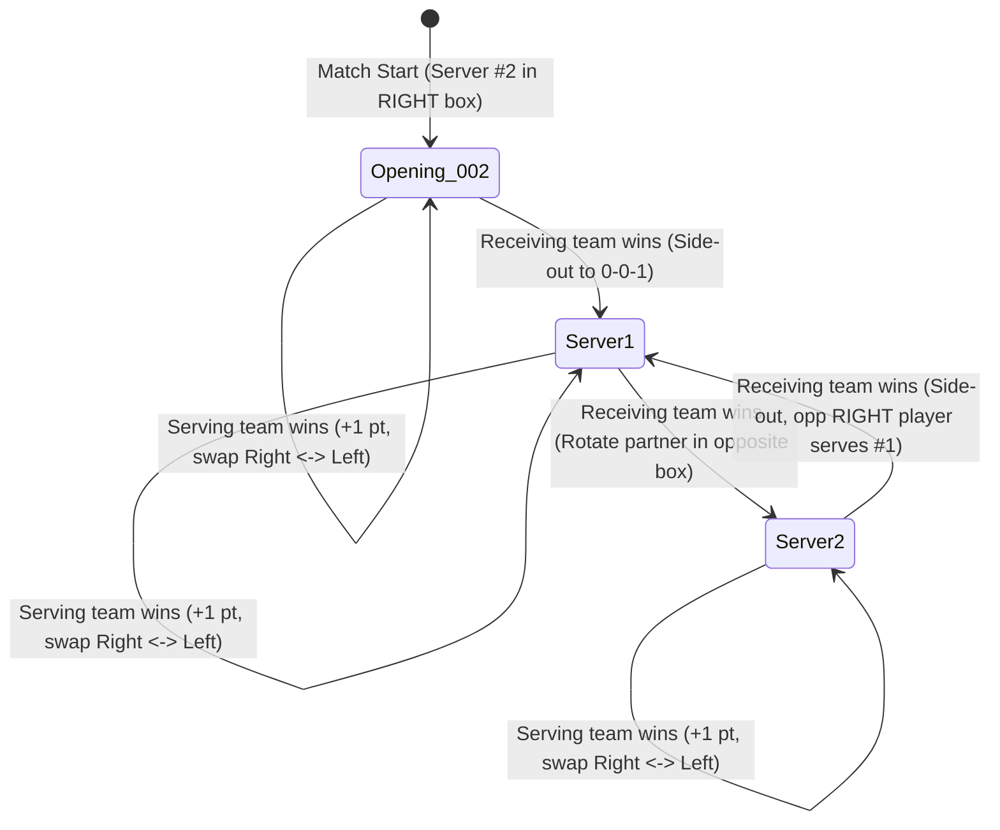

# Week 4 — Day 1 (Day 14): USAP `0-0-2` Scoring FSM & Serving Sequence (`W4-01`)

**Schedule**: Day 14 (Nov 27, 2026) | **Task Scope**: `W4-01` (Part 1: Core `0-0-2` State Machine & Serving Sequence)

---

## Architecture Delivered Today

Created the new Phase 3 Rules Engine package [`pbbase/rules/`](file:///home/pce118/Desktop/pickleball-vision-ai-main/pbbase/rules/__init__.py) cleanly decoupled from Weeks 1–3 zero-rule perception modules:

- [`pbbase/rules/__init__.py`](file:///home/pce118/Desktop/pickleball-vision-ai-main/pbbase/rules/__init__.py): Package exports for Phase 3 rules modules.
- [`pbbase/rules/scoring_fsm.py`](file:///home/pce118/Desktop/pickleball-vision-ai-main/pbbase/rules/scoring_fsm.py):
  - [`SERVICE_QUADRANT_BOUNDS_FT`](file:///home/pce118/Desktop/pickleball-vision-ai-main/pbbase/rules/scoring_fsm.py#L24-L31): Exact USAP diagonal service-court bounding boxes in feet (`X in [0, 20]`, `Y in [0, 44]` avoiding the 7-ft NVZ `[15, 29]`), handling opposing player perspectives (`Team A` facing North `Y -> 0`, `Team B` facing South `Y -> 44`).
  - [`TeamCourtState`](file:///home/pce118/Desktop/pickleball-vision-ai-main/pbbase/rules/scoring_fsm.py#L35-L78): Per-team score, Right/Left court occupancy, court swapping on serve points, and continuous USAP parity invariant validation (`verify_parity_invariant()`).
  - [`ScoringFSM`](file:///home/pce118/Desktop/pickleball-vision-ai-main/pbbase/rules/scoring_fsm.py#L139-L333):
    - Initializes match strictly at official `0-0-2` (`is_opening_half_inning = True`, single Server `#2` in Right/Even court).
    - Tracks first-server (`#1`) and second-server (`#2`) alternation inside each half-inning and diagonal receiver selection via [`get_serve_context()`](file:///home/pce118/Desktop/pickleball-vision-ai-main/pbbase/rules/scoring_fsm.py#L172-L194).
    - Advances court state and swaps serving team boxes on [`advance_rally()`](file:///home/pce118/Desktop/pickleball-vision-ai-main/pbbase/rules/scoring_fsm.py#L196-L248).
    - Seeds directly from real Weeks 2–3 perception frames via [`seed_from_telemetry_players()`](file:///home/pce118/Desktop/pickleball-vision-ai-main/pbbase/rules/scoring_fsm.py#L251-L299) and verifies live court alignment via [`validate_player_alignment()`](file:///home/pce118/Desktop/pickleball-vision-ai-main/pbbase/rules/scoring_fsm.py#L301-L334).

---

## Remaining Week 4 Schedule (Day-Wise)

| Day | Tasks | Planned Deliverable |
| :--- | :--- | :--- |
| **Day 15** *(Next)* | Complete `W4-01` & `W4-02` | Side-out ledger, full score progression, win-by-2 match completion (11/15/21 pts), rally history snapshot |
| **Day 16** | `W4-03`, `W4-04` | Two-bounce rule enforcer + Kitchen (NVZ) volley foot-fault detector |
| **Day 17** | `W4-05` | Automated IN/OUT line caller using sub-pixel `BounceEvent` landings |
| **Day 18** | `W4-06` | Unified end-to-end referee validation (`match1.mp4` + full simulated 0-0-2 games), report & tracker updates |
